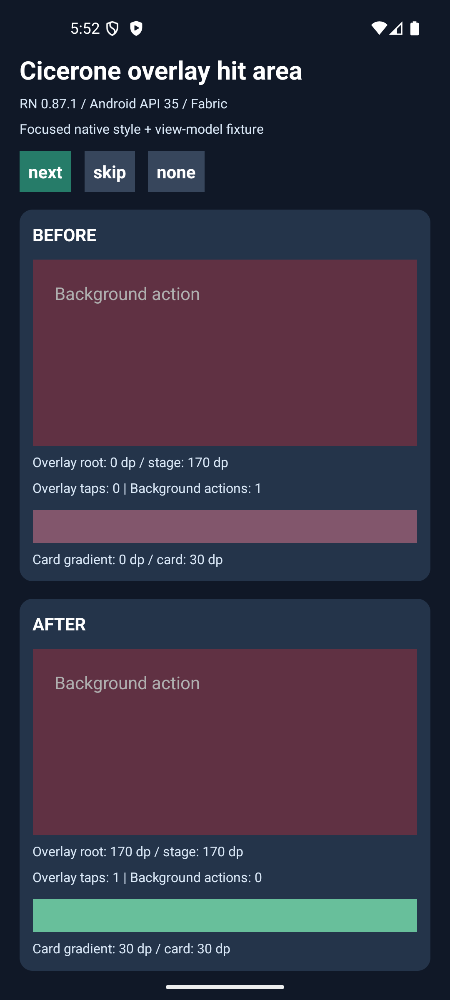

# Native hit-area verification for issue #7

This is a **focused native style + view-model fixture**, not the entire Cicerone tour. It imports the actual original and patched `useStyles` functions and the unchanged `useSpotlightViewModel`, and renders the same root `View` / overlay `Pressable` hierarchy used by `Spotlight` for `allowTargetInteraction=false`. It omits SVG scrim, Reanimated decoration and the provider. An independent dimming view represents the separately drawn scrim. The card sample is a plain native view using the real gradient style, not the animated gradient implementation.

Recorded in the same **RN 0.87.1 / React 19.2.3 / Hermes / Fabric** APK, Pixel 7 Android API 35 emulator. Debug APK, developer support disabled, embedded `--dev false` bundle. No observation code changes to library source.

| Native layout | Original `3a43f3e` | Patched `5138a5d` |
|---|---:|---:|
| Spotlight root in a 170 dp stage | 0 dp | 170 dp |
| Gradient style in a 30 dp card sample | 0 dp | 30 dp |

For one tap per case in `next` mode, the original fires the **background action**, not the overlay handler. The patch fires the **overlay handler**, not the background action. `skip` behaves the same. `none` permits the background action in both cases.



Additional captures: [skip](android-skip.png), [none](android-none.png). Counters accumulate across mode changes.

## Reproduce

Clone the fork, check out `evidence/overlay-hit-area-rn87`, then use an existing disposable RN app with dependencies installed:

```sh
python3 evidence/prepare-fixture.py /absolute/path/to/test-app
```

Use generated `CiceroneHitAreaFixture.tsx` as the app root. No Reanimated or SVG native modules are needed for this focused fixture. It creates `ciceroneBefore/` and `ciceroneAfter/`, refusing to overwrite them. Tap the middle of each stage, then switch between next, skip and none. Dimensions are read with native `onLayout`.

## Other validation

- Two new removed-export regressions: original **2 failures**, patch **2 passes**.
- Full tests showed a timing-dependent pre-existing autoStart test failure (`Does NOT start again when autoStart stays true across renders`, provider view-model test line 324) on both original and patched runs. Original rerun: **97 pass**. Patched runs: **99 pass** once, **98 pass / 1 failure** on another run. This is not claimed as a consistently green full suite.
- Full lint: zero errors/warnings. Typecheck and package build pass.
- Upstream example web export passes; opened locally, showing the tour with no captured console errors.

Native iOS, full native tour transitions, SVG rendering and target-interaction touch strips were not verified by this fixture. Existing view-model tests cover routing and touch-strip geometry; this change does not alter those algorithms.
